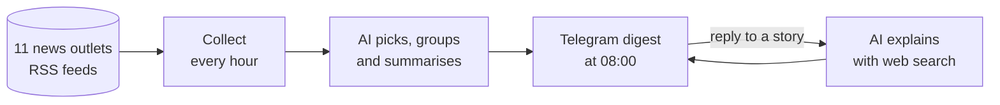

# morning-news

A personal news assistant on Telegram. Every morning at 08:00 it sends a short digest of the day's most
important stories from Portugal, the world and tech/AI, picked and summarised by an AI model.
Reply to any story to ask follow-up questions: it reads the full articles, searches the web and answers with sources.

> **Status: in progress.** News collection works (Steps 0–2 of 7). The AI, Telegram and scheduling parts are next.
> See the [project map](docs/project-map.md) for what's built and how the project evolved.

## How it works



- **Sources:** Portuguese outlets (Observador, Público, RTP, ECO), world news (BBC, The Guardian, Al Jazeera,
  The Economist) and tech (MIT Technology Review, Ars Technica, Hacker News), listed in [`config.toml`](config.toml).
- **Different perspectives:** when several outlets cover the same story, it's shown once with every source listed,
  and a follow-up question can compare how each outlet framed it.
- **Swappable blocks:** each part (sources, AI model, messenger, storage) is its own module with a small interface,
  so replacing one, e.g. switching AI provider, doesn't touch the rest.
- **Free to run:** the goal is $0 — RSS feeds, a free AI tier, Telegram and a free cloud server.

## Tech stack

Python 3.14 · feedparser · TOML config · *planned:* free-tier LLM API, python-telegram-bot, SQLite

## Run it locally

Requires Python 3.14.

```bash
git clone https://github.com/rubenvilela/morning-news.git
cd morning-news
python -m venv .venv
.venv\Scripts\Activate.ps1        # Windows PowerShell
# source .venv/bin/activate       # Linux / macOS
pip install -r requirements.txt
python -m morning_news.sources    # fetches all feeds and prints the last 24 h of headlines
```

## Project structure

```
morning-news/
├── config.toml           # news sources and settings
├── morning_news/         # the code, one module per block
│   ├── config.py         # reads config.toml
│   └── sources.py        # fetches the feeds, filters the last 24 h, cleans titles
├── docs/project-map.md   # architecture and project history (diagrams)
├── BACKLOG.md            # ideas for later, and why they were deferred
├── LEARNING_LOG.md       # what I learned at each step
└── requirements.txt
```

## About this project

I'm building this to learn how to build an AI agent end to end: data collection, LLMs with structured output,
tool use, memory, scheduling and cloud deployment. It's built step by step with Claude (Anthropic's AI) as a
pair programmer.

What I learn at each step, in my own words, is in the [learning log](LEARNING_LOG.md).
