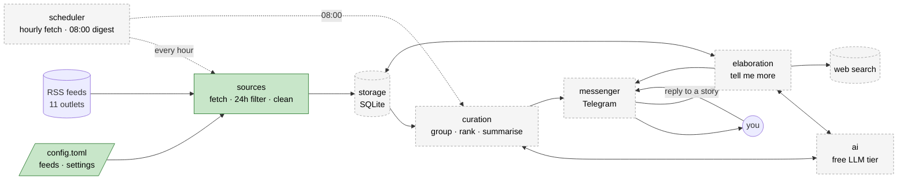
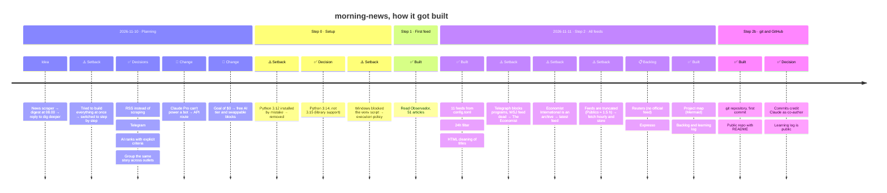

# Project map

Updated at the end of every step. Last update: end of Step 2b (2026-11-11).

## 1. Architecture: what the system is

Each box is a block (one module). Green = built, grey dashed = planned.

Runs on: my PC for now → a free cloud server in Step 7.

## 2. Journey: how it got built

✅ built or decided · 🔀 change of plan · ⚠️ setback · 📋 moved to backlog

